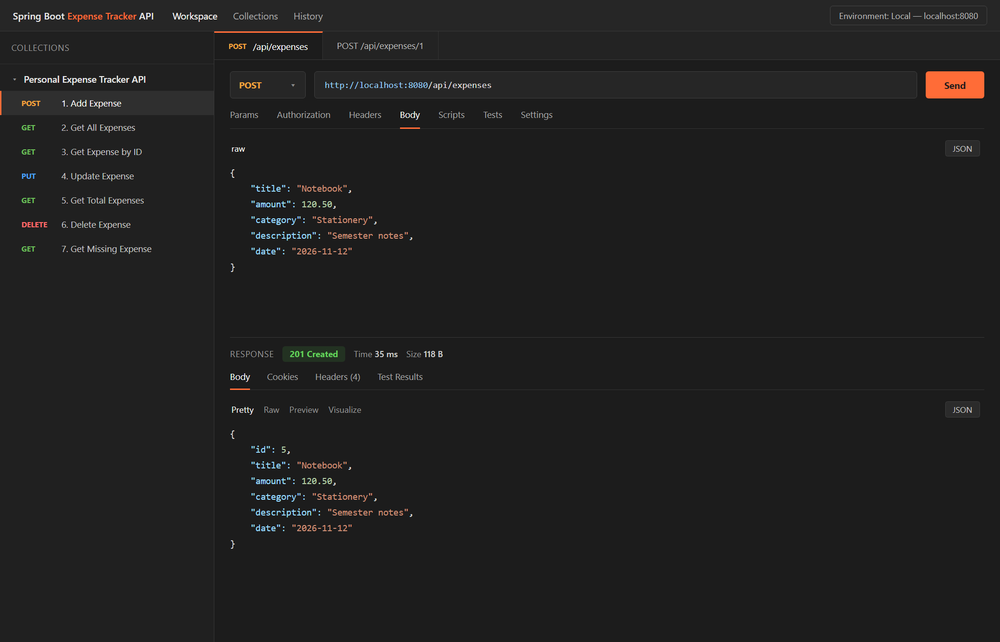
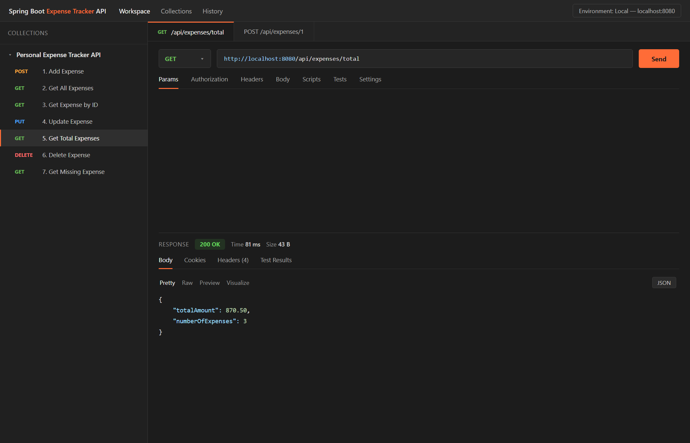

# Swaroop Kumar — 24BCS12717

## Personal Expense Tracker REST API

A beginner-friendly REST API to record and manage personal expenses, built with **Java 17**, **Spring Boot**, **Spring Data JPA** and **MySQL**.

| | |
|---|---|
| **Project type** | Individual academic project |
| **Language / Framework** | Java 17 · Spring Boot 3.5.3 |
| **Database** | MySQL 8 |

---

## 1. Project Description

**Personal Expense Tracker** is a backend-only REST API that lets a user record money spent, look it up later, change it, delete it, and see how much was spent in total.

The application follows a clean layered architecture:

```
HTTP request
    │
    ▼
Controller  ──►  Service  ──►  Repository  ──►  MySQL
 (REST/JSON)   (business)     (Spring Data JPA)   (expenses table)
    ▲
    │  JSON error (404 / 400 / 500)
 Exception handler
```

* The **Controller** only maps URLs to service calls and sets HTTP status codes.
* The **Service** contains the business logic and works with entities.
* The **Repository** is a Spring Data JPA interface – no SQL needed for CRUD.
* The **Entity** is the JPA mapping of the `expenses` table.
* The **Exception** layer converts errors into a single, consistent JSON shape.

There is **no authentication and no frontend** – the project focuses on a clean REST API that can be tested with Postman or `curl`.

---

## 2. Features

- ✅ Add a new expense
- ✅ View all expenses (newest date first)
- ✅ View a single expense by id
- ✅ Update an existing expense
- ✅ Delete an expense
- ✅ Calculate the total amount spent (plus the number of expenses)
- ✅ Request validation with clear, per-field error messages
- ✅ Central exception handling with correct HTTP status codes
- ✅ Unit tests for the service and web layer (22 tests)

---

## 3. Tech Stack

| Layer | Technology |
|---|---|
| Language | Java 17 |
| Framework | Spring Boot 3.5.3 |
| Web | Spring Web (Spring MVC) |
| Persistence | Spring Data JPA + Hibernate |
| Database | MySQL 8 |
| Validation | Jakarta Bean Validation (`spring-boot-starter-validation`) |
| Build tool | Maven (wrapper included) |
| Testing | JUnit 5, Mockito, MockMvc, AssertJ |

---

## 4. File Structure

```
spring-boot-expense-tracker/
├── pom.xml                                  # Maven dependencies and build
├── mvnw / mvnw.cmd / .mvn/                  # Maven wrapper (no local Maven needed)
├── .gitignore
├── README.md
│
├── database/
│   └── schema.sql                           # MySQL table definition (reference)
│
├── postman/
│   └── Expense-Tracker.postman_collection.json
│
├── docs/
│   └── screenshots/
│       ├── 01-add-expense-201.png
│       └── 02-total-expenses-200.png
│
└── src/
    ├── main/
    │   ├── java/com/swaroop/expensetracker/
    │   │   ├── ExpenseTrackerApplication.java          # main() – starts Spring Boot
    │   │   │
    │   │   ├── controller/
    │   │   │   └── ExpenseController.java              # REST endpoints
    │   │   │
    │   │   ├── service/
    │   │   │   └── ExpenseService.java                 # business logic
    │   │   │
    │   │   ├── repository/
    │   │   │   └── ExpenseRepository.java              # JPA repository + total query
    │   │   │
    │   │   ├── entity/
    │   │   │   └── Expense.java                        # table mapping
    │   │   │
    │   │   ├── dto/
    │   │   │   ├── ExpenseRequest.java                 # input + validation rules
    │   │   │   ├── ExpenseResponse.java                # output
    │   │   │   ├── TotalExpenseResponse.java           # output of /total
    │   │   │   └── ErrorResponse.java                  # error body
    │   │   │
    │   │   └── exception/
    │   │       ├── ExpenseNotFoundException.java       # 404 case
    │   │       └── GlobalExceptionHandler.java         # @RestControllerAdvice
    │   │
    │   └── resources/
    │       └── application.properties                  # MySQL + JPA configuration
    │
    └── test/
        └── java/com/swaroop/expensetracker/
            ├── controller/
            │   └── ExpenseControllerTest.java          # MockMvc web tests
            └── service/
                └── ExpenseServiceTest.java             # Mockito unit tests
```

---

## 5. Getting Started

### 5.1 Prerequisites

- **JDK 17 or newer** (`java -version`)
- **MySQL 8** running on `localhost:3306`
- No Maven installation required – the Maven wrapper is included.
- Postman (optional, for manual testing)

### 5.2 Create the database

The application creates the schema automatically (`createDatabaseIfNotExist=true` and `ddl-auto=update`), but you can also create it manually:

```bash
mysql -u root -p < database/schema.sql
```

### 5.3 Configure the credentials

The datasource reads its credentials from environment variables, so **no password is stored in the repository**:

```properties
spring.datasource.url=jdbc:mysql://localhost:3306/expense_tracker_db?createDatabaseIfNotExist=true&useSSL=false&allowPublicKeyRetrieval=true&serverTimezone=UTC
spring.datasource.username=${DB_USERNAME:root}
spring.datasource.password=${DB_PASSWORD}
```

Set the variables in the same terminal before starting the application:

**PowerShell (Windows)**

```powershell
$env:DB_USERNAME = "root"
$env:DB_PASSWORD = "your-mysql-password"
mvnw.cmd spring-boot:run
```

**CMD / macOS / Linux**

```bash
export DB_USERNAME=root
export DB_PASSWORD="your-mysql-password"
./mvnw spring-boot:run
```

`DB_USERNAME` defaults to `root`; `DB_PASSWORD` has no default, so a missing value fails fast at start-up instead of silently using a hard-coded password. Never commit credentials – keep them in your shell or a local file that is git-ignored.

### 5.4 Run the application

```bash
# Windows
mvnw.cmd spring-boot:run

# macOS / Linux
./mvnw spring-boot:run
```

The API starts at **http://localhost:8080**.

You can also build a jar and run it:

```bash
mvnw.cmd clean package
java -jar target/expense-tracker-1.0.0.jar
```

### 5.5 Run the tests

```bash
mvnw.cmd test
```

The service tests use Mockito and the controller tests use MockMvc, so **no database is required** to run the test suite.

---

## 6. API Endpoints

**Base URL:** `http://localhost:8080`

| # | Method | Endpoint | Description | Success | Errors |
|---|--------|----------|-------------|---------|--------|
| 1 | `POST` | `/api/expenses` | Add a new expense | `201 Created` | `400` |
| 2 | `GET` | `/api/expenses` | Get all expenses | `200 OK` | – |
| 3 | `GET` | `/api/expenses/{id}` | Get one expense by id | `200 OK` | `400`, `404` |
| 4 | `PUT` | `/api/expenses/{id}` | Update an expense | `200 OK` | `400`, `404` |
| 5 | `DELETE` | `/api/expenses/{id}` | Delete an expense | `204 No Content` | `400`, `404` |
| 6 | `GET` | `/api/expenses/total` | Total amount + number of expenses | `200 OK` | – |

### 6.1 Add an expense — `POST /api/expenses`

Request body:

```json
{
  "title": "Notebook",
  "amount": 120.50,
  "category": "Stationery",
  "description": "Semester notes",
  "date": "2026-11-12"
}
```

Response — `201 Created`:

```json
{
  "id": 5,
  "title": "Notebook",
  "amount": 120.50,
  "category": "Stationery",
  "description": "Semester notes",
  "date": "2026-11-12"
}
```

### 6.2 Get all expenses — `GET /api/expenses`

Response — `200 OK` (ordered by date, newest first):

```json
[
  {
    "id": 5,
    "title": "Notebook",
    "amount": 120.50,
    "category": "Stationery",
    "description": "Semester notes",
    "date": "2026-11-12"
  },
  {
    "id": 4,
    "title": "Metro card",
    "amount": 500.00,
    "category": "Travel",
    "description": "Monthly recharge",
    "date": "2026-11-11"
  },
  {
    "id": 3,
    "title": "Lunch",
    "amount": 250.00,
    "category": "Food",
    "description": "Team lunch at office",
    "date": "2026-11-10"
  }
]
```

### 6.3 Get one expense — `GET /api/expenses/{id}`

Response — `200 OK`:

```json
{
  "id": 3,
  "title": "Lunch",
  "amount": 250.00,
  "category": "Food",
  "description": "Team lunch at office",
  "date": "2026-11-10"
}
```

Unknown id — `404 Not Found`:

```json
{
  "timestamp": "2026-11-13T09:28:26.0440926",
  "status": 404,
  "error": "Not Found",
  "message": "Expense not found with id: 9999",
  "path": "/api/expenses/9999"
}
```

### 6.4 Update an expense — `PUT /api/expenses/{id}`

`PUT` replaces the whole expense, so every field must be sent.

Request body:

```json
{
  "title": "Dinner",
  "amount": 400.00,
  "category": "Food",
  "description": "Family dinner",
  "date": "2026-11-11"
}
```

Response — `200 OK`:

```json
{
  "id": 3,
  "title": "Dinner",
  "amount": 400.00,
  "category": "Food",
  "description": "Family dinner",
  "date": "2026-11-11"
}
```

### 6.5 Delete an expense — `DELETE /api/expenses/{id}`

Response — `204 No Content` (empty body).  
Unknown id → `404 Not Found` with the same error shape as above.

### 6.6 Total expenses — `GET /api/expenses/total`

Response — `200 OK`:

```json
{
  "totalAmount": 870.50,
  "numberOfExpenses": 3
}
```

`totalAmount` is `0` when the table is empty (thanks to `COALESCE(SUM(amount), 0)`).

---

## 7. Validation Rules

Validation runs on the request DTO (`ExpenseRequest`) through `@Valid`. If a rule fails, the API answers `400 Bad Request` and lists every invalid field.

| Field | Rule | Error message |
|-------|------|---------------|
| `title` | required, max 100 characters | `Title is required` |
| `amount` | required, greater than 0, max 2 decimals | `Amount must be greater than zero` |
| `category` | required, max 50 characters | `Category is required` |
| `description` | optional, max 255 characters | `Description must be at most 255 characters` |
| `date` | required, ISO format `yyyy-MM-dd` | `Date is required (format yyyy-MM-dd)` |

Example — invalid request:

```json
{
  "title": "  ",
  "amount": -10,
  "category": "",
  "date": null
}
```

Response — `400 Bad Request`:

```json
{
  "timestamp": "2026-11-13T09:28:25.5671847",
  "status": 400,
  "error": "Bad Request",
  "message": "Validation failed. Please check the highlighted fields.",
  "path": "/api/expenses",
  "fieldErrors": {
    "title": "Title is required",
    "amount": "Amount must be greater than zero",
    "category": "Category is required",
    "date": "Date is required (format yyyy-MM-dd)"
  }
}
```

### Error responses summary

| Status | When it happens |
|--------|-----------------|
| `400 Bad Request` | validation failed, malformed JSON, wrong date format, non-numeric id |
| `404 Not Found` | the requested expense id does not exist |
| `500 Internal Server Error` | any unexpected server error (details are logged, not exposed) |

---

## 8. Database Schema

Database name: **`expense_tracker_db`**  
Table name: **`expenses`**

```sql
CREATE TABLE expenses (
    id          BIGINT         NOT NULL AUTO_INCREMENT,
    title       VARCHAR(100)   NOT NULL,
    amount      DECIMAL(12,2)  NOT NULL,
    category    VARCHAR(50)    NOT NULL,
    description VARCHAR(255)   DEFAULT NULL,
    date        DATE           NOT NULL,
    PRIMARY KEY (id)
);
```

| Column | Type | Constraints | Description |
|--------|------|-------------|-------------|
| `id` | `BIGINT` | Primary key, auto increment | Unique expense id |
| `title` | `VARCHAR(100)` | `NOT NULL` | Short name of the expense |
| `amount` | `DECIMAL(12,2)` | `NOT NULL` | Money spent (2 decimal places) |
| `category` | `VARCHAR(50)` | `NOT NULL` | e.g. Food, Travel, Stationery |
| `description` | `VARCHAR(255)` | nullable | Optional note |
| `date` | `DATE` | `NOT NULL` | Date of the expense |

Hibernate creates/updates this table automatically on start-up. The same definition is available in [`database/schema.sql`](database/schema.sql).

---

## 9. Testing with Postman

1. Import [`postman/Expense-Tracker.postman_collection.json`](postman/Expense-Tracker.postman_collection.json) into Postman.
2. Keep the collection variable `baseUrl` at `http://localhost:8080`.
3. Start the application, then run the requests from **1. Add Expense** to **6. Delete Expense** in order.

The collection includes small test scripts that assert the expected status codes (`201`, `200`, `204`, `404`).

---

## 10. Postman Verification Screenshots

**1. Add expense — `POST /api/expenses` → `201 Created`**



**2. Total expenses — `GET /api/expenses/total` → `200 OK`**



---

## 11. Key Implementation Notes

- **DTOs instead of entities in the API** – `ExpenseRequest` / `ExpenseResponse` keep the database model separate from the JSON contract.
- **`@Transactional`** is used on write operations and `readOnly = true` on read operations.
- **`BigDecimal` for money**, never `double`, so amounts stay exact.
- **`@RestControllerAdvice`** handles every exception, so controllers contain no try/catch blocks.
- **Constructor injection** is used everywhere (no field injection), which makes the classes easy to test.
- **Sorting** (`date DESC, id DESC`) is done in the repository call, not in Java.

---

## 12. Author

**Swaroop Kumar**  
University ID: **24BCS12717**

Built as a learning project for Spring Boot REST API development.
